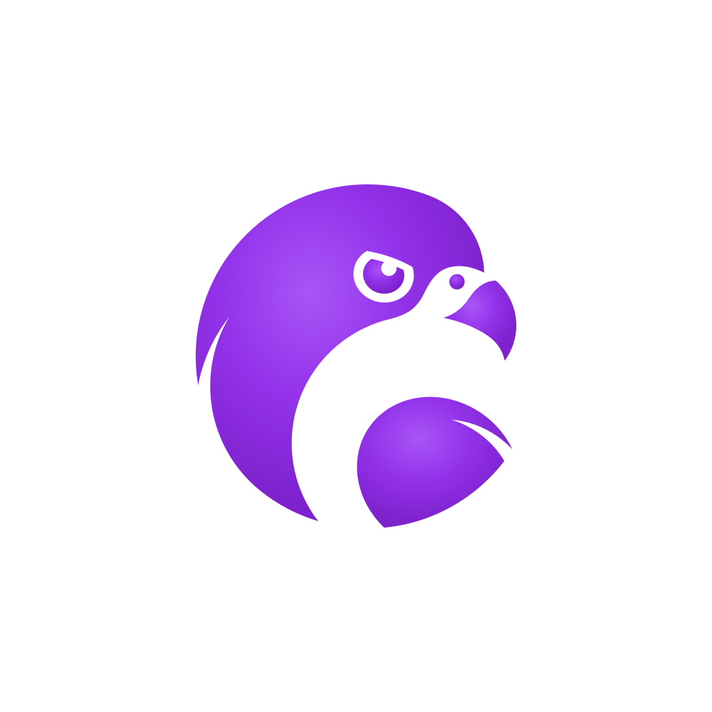
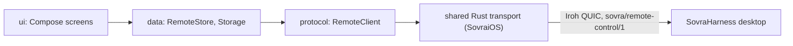

<p align="center">
  
</p>

<h1 align="center">SovraAndroid</h1>

<p align="center">
  Use Sovra on your computer from your Android phone.<br>
  Native Kotlin and Jetpack Compose, with a Rust transport shared with iOS.
</p>

<p align="center">
  <a href="#quick-start">Getting started</a>
  ·
  <a href="docs/README.md">Documentation</a>
  ·
  <a href="https://github.com/Sovra-AI/SovraHarness">SovraHarness</a>
  ·
  <a href="https://github.com/Sovra-AI/SovraiOS">SovraiOS</a>
  ·
  <a href="CONTRIBUTING.md">Contributing</a>
  ·
  <a href="CHANGELOG.md">Changelog</a>
</p>

Pair once by scanning a code shown by [SovraHarness](https://github.com/Sovra-AI/SovraHarness)
on your computer. After that, opening the app connects to that computer by itself, on the
same Wi-Fi or over mobile data, end-to-end encrypted.

> **License:** Source on `main` is available under n8n's Sustainable Use License,
> which n8n's docs allow other projects to use. This is fair-code:
> source-available, and not an OSI open-source license. Enterprise files have
> separate terms. See [License](#license).

## What you can do

- **Chat:** read the conversation as bubbles with Sovra's formatting, write a message that
  is typed through Sovra's real chat box, pick `/` skills, and press **Stop**.
- **Chats:** browse every chat in Sovra's sidebar, search, show older chats, or start a
  new one.
- **Skills:** search Sovra's `/` skills; picking one starts a message with it.
- **Computer:** jump to Sovra's pages, see a live picture of its window or a list of its
  controls, press keyboard keys, and type into any box there.

The app controls the Sovra window only, not your operating system, files, or shell. It
matches [SovraiOS](https://github.com/Sovra-AI/SovraiOS) screen for screen.

## Quick start

### Use the app

No Play Store build or APK release is published yet; [build from source](#build-from-source).

1. On your computer, in Sovra: **Skills → Use Sovra from your phone** (or `/remote-control`).
2. In the app: **Scan the code**, or open the `sovra://remote-control` link on the phone.
   The code works once and expires after five minutes.
3. Next time, just open the app. If it says **Start remote control on your computer**, run
   the skill again: phone access switches off whenever Sovra restarts. Your phone stays paired.

To revoke a phone, choose **Forget** for it in Sovra on your computer. **Settings → Forget
this computer** on the phone only removes the computer from the phone.

### Build from source

You need JDK 17+, the Android SDK (compileSdk 37) and NDK, Rust through rustup, and
`cargo-ndk`. The Rust transport lives in [SovraiOS](https://github.com/Sovra-AI/SovraiOS)
(`modules/sovra-remote/rust`), one crate for both apps, so clone it alongside:

```sh
git clone https://github.com/Sovra-AI/SovraAndroid.git
git clone https://github.com/Sovra-AI/SovraiOS.git
cd SovraAndroid
export RUST_CRATE=../SovraiOS/modules/sovra-remote/rust   # default: ../SovraReactNative/…
cargo install cargo-ndk
rustup target add aarch64-linux-android x86_64-linux-android
scripts/build-rust.sh                           # Iroh transport for arm64-v8a + Kotlin bindings
ABIS="arm64-v8a x86_64" scripts/build-rust.sh   # also Intel emulators
./gradlew :app:installDebug                     # debug build on a device or emulator
```

Debug builds use the id `ai.sovra.remote.native`, so they sit beside a development build of
the SovraiOS code on Android; release builds use `ai.sovra.remote`. See
[Development](docs/development.md).

## Status and data boundaries

The app is under active development. Read the [changelog](CHANGELOG.md) for changes and
the [documentation](docs/README.md) for current behavior.

- The phone talks only to the computer it paired with. It uses Iroh QUIC with that
  computer's key pinned, directly or through Iroh's encrypted relays, so relays and address
  lookup see connection metadata but not content.
- The pairing link is a single-use bearer invitation. The app never logs or stores it and
  drops it from the launching intent once read.
- The phone key is encrypted with an Android Keystore key and excluded from backups and
  device transfer.
- The app works only while it is open on screen. It cannot wake a closed app or a sleeping
  computer, and there are no push notifications.
- Reading replies uses desktop screenshots where the desktop can capture them; otherwise
  only labelled text is shown.

See [Security](SECURITY.md) for reporting and the
[desktop phone-control contract](https://github.com/Sovra-AI/SovraHarness/blob/main/docs/remote-control.md)
for the protocol.

## Development

| Command | Purpose |
| --- | --- |
| `scripts/build-rust.sh` | Build the shared Rust transport and generate the Kotlin bindings |
| `./gradlew :app:testDebugUnitTest` | Protocol tests against the desktop fixtures; must pass before every commit |
| `./gradlew :app:installDebug` | Debug build and install on a device or emulator |

See [CONTRIBUTING.md](CONTRIBUTING.md) for the pull request workflow and
[AGENTS.md](AGENTS.md) for engineering rules.

### Architecture

Protocol decisions are pure Kotlin in `protocol/` and are unit-tested. The shared Rust
crate only moves bytes. Compose screens render state from `data/RemoteStore`.



Read [Architecture](docs/architecture.md) for the layers and the rules the client enforces.

## Documentation

| Guide | Covers |
| --- | --- |
| [Development](docs/development.md) | Prerequisites, builds, tests, and the project layout |
| [Architecture](docs/architecture.md) | Layers, protocol rules, pairing, and secrets |
| [Documentation index](docs/README.md) | All guides |

## Contributing and support

Bug reports, feature requests, documentation improvements, and code contributions are
welcome. Search [existing issues](https://github.com/Sovra-AI/SovraAndroid/issues) before
opening a new one, and follow [CONTRIBUTING.md](CONTRIBUTING.md) when submitting a pull
request. Include your app commit, device and Android version, desktop version, and
reproduction steps; remove pairing links, credentials, and personal data from logs and
screenshots.

Follow the [Code of Conduct](CODE_OF_CONDUCT.md) in project spaces. Report
vulnerabilities using [SECURITY.md](SECURITY.md), without posting exploit details in
public issues.

## License

[LICENSE](LICENSE) contains n8n's Sustainable Use License, Version 1.0, with Sovra as the
licensor. This is a fair-code license with use and distribution restrictions, not an OSI
open-source license. It applies to source on `main`; the license excludes other branches.
Files with `.ee.` in their name or `.ee` in their directory name are covered separately by
[LICENSE_EE.md](LICENSE_EE.md). Third-party components, such as the Gradle wrapper, retain
their own licenses.
