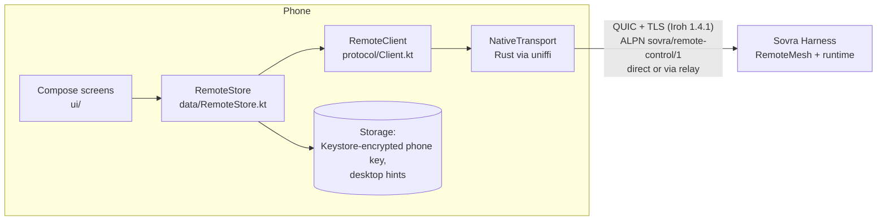

# Architecture

The desktop owns the contract: [SovraHarness `docs/remote-control.md`](https://github.com/Sovra-AI/SovraHarness/blob/main/docs/remote-control.md),
`crates/sovra-core/src/remote_control/` and the reference client
`crates/sovra-runtime/src/remote_reference.rs`. This app implements its phone side, and keeps
the same behavior as [SovraiOS](https://github.com/Sovra-AI/SovraiOS): a change to its
`src/remote/` belongs here too, and the other way round.

## Layers

| Layer | Owns | Must not |
| --- | --- | --- |
| Shared Rust crate | Iroh endpoint with the phone key; dial a pinned desktop key; one JSON message per bidirectional stream; size limits and transport deadlines | Make protocol decisions, retry, or persist anything |
| `protocol/` | Wire types, strict ticket parsing, Hello/session/sequence, revision-guarded mutations, and the readers for Sovra's screens | Touch Android, storage, or the network directly (takes a `PhoneTransport`) |
| `data/` | Lifecycle (foreground only), 1–30 s backoff, error → recovery mapping, persistence, the native transport | Parse desktop messages to decide behavior (codes only) |
| `ui/` | Compose rendering and input | Hold protocol state |

The transport is one Rust crate for both apps: SovraiOS's `modules/sovra-remote/rust`.
[scripts/build-rust.sh](../scripts/build-rust.sh) builds it from `RUST_CRATE` (default: a
sibling `../SovraiOS` checkout, or `../SovraReactNative`), and [uniffi.toml](../uniffi.toml) adds the
Kotlin-only renames. Its Kotlin bindings in `app/src/main/java/uniffi/` and the libraries in `app/src/main/jniLibs/`
are generated by that script and never committed.

## Protocol rules the client enforces

- **Hello first.** Every new connection sends Hello, and the sequence restarts at 1. A
  sequence number is consumed before sending, even if the request fails.
- **Session renewal** after 4096 requests (`MAX_SESSION_REQUESTS`).
- **Inspect before every mutation.** Each mutation carries the revision of an inspection
  taken immediately before it, in the same session.
- **Only `stale_observation` is retried** (up to 4 times), because the desktop rejects it
  before delivering anything.
- **Reads reconnect once; mutations never do.** A lost reply to a mutation is
  `outcome_unknown`; the app says so and never replays it.
- **Unreachable ≠ revoked.** Only `not_paired` sends the person back to pairing.
- **Foreground only.** The remote screen refreshes while resumed and stops on pause, which
  also keeps the desktop's 5 s idle timer from closing the connection.
- **One request in flight.** All calls are serialized through one lock.

## Pairing and secrets

- The phone key is encrypted with an AES key held in the Android Keystore. Backup and
  device transfer are excluded in the manifest and data-extraction rules.
- The `sovra://remote-control` link is a bearer invitation. The activity reads it, pairs,
  and drops it from its intent. It is never logged, stored, or sent anywhere but the
  encrypted channel.
- The desktop key from the QR is pinned by the transport before any request.
- Only public routing hints and a display name are saved after pairing.

## Reaching the computer from any network

The transport is Iroh QUIC with TLS 1.3 and raw public keys: the phone pins the desktop key
from the pairing code, and the desktop allows only phones it paired. On the same network the
phone dials the desktop's LAN addresses directly. Elsewhere it looks the desktop up by key at
`dns.iroh.link` (over HTTPS) and connects through the desktop's encrypted Iroh relay, which
works over TCP 443 where UDP is blocked; Iroh then tries to punch a direct path and moves
the connection onto it. Relays see which keys talk and how much, never the content.

- **DNS comes from the phone's own resolver.** Iroh normally reads nameservers itself:
  through SystemConfiguration on Apple, which the iOS sandbox hides, and through JNI on
  Android, which needs a context this app never installs. It then falls back to fixed public
  resolvers that many mobile, IPv6-only and corporate networks block, so relay hostnames
  never resolved and only the LAN addresses in the pairing code worked. `OsFirstResolver` in
  the shared transport (SovraiOS `modules/sovra-remote/rust`) asks `getaddrinfo` first. That honours the network's DNS, DNS64/NAT64, VPNs
  and Private DNS. TXT lookups and OS failures still go to Iroh's resolver.
- **The pairing code carries the relay.** SovraHarness waits up to three seconds for its
  relay before encoding the code. Older desktops encode LAN addresses only; the phone still
  finds them by key.
- **The path is shown.** `DesktopConnection.route()` reports `direct` or `relay`, and the status
  line says "Connected directly" or "Connected through an encrypted relay".

`phone_reaches_desktop_by_key_alone_through_a_relay` in the transport tests (ignored by
default; it needs the Internet) dials a desktop by key with LAN sockets disabled.

To check this without leaving the building, firewall an Android emulator (`adb root`) so it
behaves like a strict network: drop all UDP except the emulator's DNS at `10.0.2.3`, drop
private ranges and your own public IP (no LAN or hairpin path), and drop 1.1.1.1, 8.8.8.8 and
9.9.9.9 (third-party DNS blocked). On 2026-11-13 the current build connected under those rules
and showed "Connected through an encrypted relay"; the build before `OsFirstResolver` sent over
11,000 packets to the blocked resolvers and stayed on "Can't reach your computer".

## Connection progress

While it is not connected, the remote screen shows each step (secure endpoint ready, reaching
the computer), how long it has been trying, the attempt number, the last failure and a
countdown to the next try with **Try now**. From the third attempt it lists what to check on
the computer. A reconnect that finishes within 1.5 s shows only "Connecting…" in the status
line, so coming back to the app does not flash the card. Pairing shows a ticking elapsed time.
The wording lives in one pure function (`data/ConnectionStatus.kt`), with the same tests in both apps.

## Tests

`app/src/test/` holds JUnit tests for the protocol. `ProtocolTest` checks the wire format
byte-for-byte against fixtures copied from the desktop into
`app/src/test/resources/fixtures/`, and `FakeDesktop` is an in-memory desktop for client and
screen-reader tests. Every SovraiOS test has a counterpart here; [test-parity.md](test-parity.md)
maps them. `app/src/androidTest/` holds Compose UI tests that need a device, such as pinch to
zoom on the Computer tab's picture.
